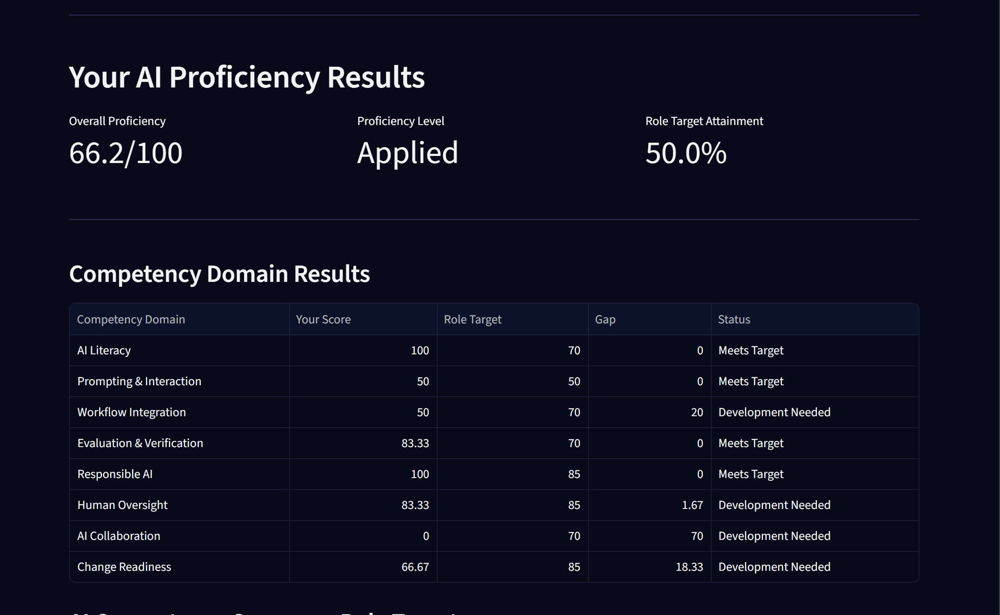

# AI Workforce Learning & Proficiency Framework

**Python | Streamlit | Plotly | Pandas | Workforce Analytics | AI Competency Assessment**

A Python and Streamlit application designed to assess individual AI proficiency, identify role-specific competency gaps, generate personalized learning recommendations, and analyze organizational AI workforce readiness.

The framework integrates a **24-question competency assessment**, six employee-role profiles, eight competency domains, and an interactive analytics dashboard using **1,500 synthetic employee records**.

**Project Status:** Functional Prototype  
**Focus:** Applied AI | Workforce Development | Learning Analytics | Assessment Design  
**Dataset:** Synthetic / Demonstration

---

## 1. Project Overview

As organizations introduce artificial intelligence into workplace operations, workforce development requires more than providing employees with access to AI tools. Organizations also need methods for understanding employee proficiency, identifying development needs, measuring readiness across different job functions, and prioritizing learning opportunities.

The **AI Workforce Learning & Proficiency Framework** demonstrates how structured assessments, transparent scoring methods, personalized learning activities, and interactive analytics can work together to support workforce development.

The application consists of two primary components.

### Individual AI Proficiency Assessment

An interactive, role-based assessment evaluating AI knowledge, practical decision-making, and self-reported practices across eight competency domains.

Employees can review their responses before submission and receive proficiency results, role-specific competency comparisons, and personalized learning recommendations.

### Organizational AI Workforce Analytics

An interactive dashboard examining simulated employee proficiency, training participation, AI adoption, management support, and organizational competency gaps.

Users can filter workforce results by department and employee role, identify training priorities, and export recommended learning activities.

---

## 2. Application Preview

### Individual Assessment


*Employee role selection and structured AI competency assessment.*

### Organizational Workforce Analytics


*Interactive dashboard showing workforce filters, proficiency indicators, role-target attainment, and competency gaps.*

<details>
<summary>View additional individual assessment screenshots (2–7)</summary>





</details>

<details>
<summary>View additional workforce analytics screenshots (2–6)</summary>


</details>

---

## 3. Key Features

### Individual Assessment

- 24 questions across eight AI competency domains
- Six employee-role profiles
- Practical, knowledge, and reflection-based assessment items
- Weighted overall proficiency scoring
- Domain-level competency scores
- Role-specific proficiency targets
- Assessment progress tracking
- Response review before submission
- Interactive competency visualizations
- Personalized learning recommendations
- Four learning priority classifications
- Ability to start a new assessment

### Workforce Analytics

- Interactive department and employee-role filters
- Organizational proficiency scorecards
- Workforce proficiency distribution
- Department-level proficiency comparisons
- Organizational competency scores
- Approved AI tool access indicators
- Employee training participation
- AI usage frequency
- Management support measures
- Role-specific competency gap analysis
- Organizational learning priorities
- Downloadable learning priorities in CSV format

---

## 4. AI Competency Framework

The assessment evaluates eight domains representing different dimensions of AI knowledge, workplace application, responsibility, and organizational readiness.

| Competency Domain | Assessment Focus |
|---|---|
| AI Literacy | Understanding AI concepts, capabilities, and limitations |
| Prompting & Interaction | Communicating effectively with AI systems |
| Workflow Integration | Incorporating AI into work processes |
| Evaluation & Verification | Assessing and validating AI-generated outputs |
| Responsible AI | Privacy, fairness, bias, and responsible AI use |
| Human Oversight | Human judgment, accountability, and supervision |
| AI Collaboration | Working effectively with AI-assisted processes |
| Change Readiness | Adapting to AI-related workplace changes |

Each competency domain contains three assessment questions, resulting in 24 questions overall.

These domains connect the individual assessment with organizational competency analytics and learning recommendations.

---

## 5. Employee Role Profiles

The framework supports six employee-role profiles with differentiated proficiency expectations.

| Employee Role | Primary Responsibilities |
|---|---|
| Individual Contributor | Uses AI to support individual work activities |
| People Manager | Oversees employees and supports responsible AI adoption within teams |
| Learning & Development Professional | Supports workplace learning, training, and competency development |
| Data or Technical Professional | Works with data, analytics, technical systems, or AI applications |
| AI Workflow Owner | Supports AI-enabled workflow implementation and management |
| Senior Leader | Provides organizational strategy, governance, and oversight |

Role-specific competency expectations are stored in:

`data/role_targets.json`

Each role is assigned a target proficiency level for each of the eight competency domains.

These role definitions and target levels are prototype design assumptions rather than externally validated occupational standards.

---

## 6. Individual Assessment Design

The assessment includes three categories of questions.

| Category | Purpose | Weight |
|---|---|---:|
| Practical | Scenario-based application and decision-making | 60% |
| Knowledge | Understanding AI concepts and appropriate use | 30% |
| Reflection | Self-reported practices and awareness | 10% |
| **Total** | | **100%** |

Each assessment question includes scored response options, with scores ranging from 0 to 4.

Questions may have different numbers of response options based on their scenario or structure. All items use the same maximum possible score of four points for normalization.

### Assessment Navigation

The application guides employees through eight competency sections and tracks their assessment progress.

Before submitting, employees can review completed responses and return to individual competency sections.

After all 24 questions are completed, the assessment becomes ready for submission.

### Assessment Interpretation

The questions provide structured developmental indicators through knowledge items, scenario-based decisions, and self-reported practices.

The assessment does not independently observe employee job performance and has not undergone formal psychometric validation.

Because each domain contains only three questions, domain-level scores should be interpreted as preliminary developmental indicators.

---

## 7. Scoring Methodology

The application uses transparent, rule-based calculations implemented in:

`scoring/proficiency_scoring.py`

### 7.1 Assessment Category Scores

Scores within each assessment category are normalized to a 0–100 scale.

**Formula:**

Category Score = (Points Earned / Maximum Available Points) × 100

The maximum available points equal the number of questions in a category multiplied by four.

### 7.2 Overall AI Proficiency

The overall proficiency score uses weighted category results.

**Formula:**

Overall Proficiency = (Practical × 0.60) + (Knowledge × 0.30) + (Reflection × 0.10)

**Illustrative calculation:**

| Category | Score | Weight | Weighted Result |
|---|---:|---:|---:|
| Practical | 75 | 60% | 45 |
| Knowledge | 80 | 30% | 24 |
| Reflection | 60 | 10% | 6 |
| **Overall Proficiency** | | | **75/100** |

The model emphasizes practical application and decision-making.

These weights are explicit design choices, not empirically validated predictors of workplace performance.

### 7.3 Competency Domain Scores

Each domain contains three questions with a maximum score of four points each.

**Maximum Domain Points:**

3 × 4 = 12

**Formula:**

Domain Score = (Domain Points Earned / 12) × 100

**Example:**

An employee earns 8 of 12 possible points in AI Literacy.

(8 / 12) × 100 = **66.67/100**

Domain scores are calculated independently.

The overall proficiency score uses weighted assessment categories, while domain scores measure performance on questions associated with individual competencies.

---

## 8. Role-Specific Proficiency Targets

Each competency domain is evaluated against a target associated with the employee's selected role.

| Target Level | Required Score |
|---|---:|
| Level 1 | 25 |
| Level 2 | 50 |
| Level 3 | 70 |
| Level 4 | 85 |

Employees meet a competency target when their actual domain score equals or exceeds the required threshold.

### Competency Gap Calculation

**Formula:**

Competency Gap = Maximum of (0, Target Score − Actual Score)

**Example:**

- Target score: 70
- Actual score: 50
- Competency gap: 20 points

### Role-Target Attainment

Role-target attainment represents the percentage of competency domains in which an employee meets the assigned proficiency target.

**Formula:**

Role-Target Attainment = (Domains Meeting Target / 8) × 100

If an employee meets five of eight competency targets:

(5 / 8) × 100 = **62.5%**

Role-target attainment is not interchangeable with overall AI proficiency.

### Discrete Score Considerations

Domain results are derived from a limited number of scored questions, creating discrete score possibilities.

Therefore, small adjustments to proficiency thresholds may not always change an employee's attainment classification.

---

## 9. Personalized Learning Recommendations

After completing the assessment, employees receive learning recommendations linked to competencies that fall below their assigned role targets.

The recommendation system is deterministic and rule-based. It uses explicit Python conditions and a predefined learning catalog rather than generating recommendations through a language model.

Learning activities are stored in:

`data/learning_catalog.json`

### Priority Classification

| Priority | Classification Rule |
|---|---|
| Critical | Responsible AI or Human Oversight gap of at least 20 points |
| High | Other qualifying gaps of at least 30 points |
| Moderate | Remaining gaps of at least 10 points |
| Low | Remaining positive gaps below 10 points |

Rules are evaluated in order.

For example, a Responsible AI gap of 35 points receives a Critical priority rather than High.

Recommendations are sorted first by priority level and then by gap magnitude.

Competencies meeting their assigned role targets are excluded from recommendations.

### Learning Recommendation Details

Each recommended activity includes:

- Competency domain
- Learning title
- Learning objective
- Suggested learning activity
- Estimated completion time
- Competency gap
- Priority classification

Priority thresholds are prototype development rules. A Critical priority indicates a designated learning need, not a validated determination of workplace risk or employee qualification.

---

## 10. Organizational AI Workforce Analytics

The organizational dashboard demonstrates how individual assessment indicators can be examined across a simulated workforce.

The dataset includes 1,500 synthetic employees distributed across eight departments and six employee roles.

### Workforce Overview Metrics

| Metric | Calculation |
|---|---|
| Employees | Number of employee records after filtering |
| Average AI Proficiency | Mean of overall proficiency scores |
| Average Role Attainment | Mean of individual attainment percentages |
| Average Competency Gaps | Mean number of unmet competency targets per employee |

These measures are recalculated according to the selected department and employee-role filters.

### Synthetic Demonstration Results

| Workforce Indicator | Result |
|---|---:|
| Employees | 1,500 |
| Average AI Proficiency | 57.3/100 |
| Average Role Attainment | 32.6% |
| Average Competency Gaps | 5.4 |
| Approved AI Tool Access | 48.1% |
| Training Completed | 31.7% |
| Daily AI Usage | 21.3% |
| Average Manager Support | 3.0/5 |

These values come from generated demonstration records and do not represent actual organizational outcomes.

### Workforce Proficiency Distribution

The dashboard visualizes the number of employees in each proficiency classification:

- Foundational
- Developing
- Applied
- Advanced
- Advanced (Leadership Review Eligible)

The classifications are based on overall proficiency scores generated through the assessment scoring model. The leadership-review label denotes eligibility for additional review within this prototype, not a leadership credential or certification.

### AI Proficiency by Department

A horizontal bar chart compares average AI proficiency scores across the eight simulated departments. Scores range from 0 to 100 and are recalculated when department or employee-role filters change.

### Organizational Competency Scores

The dashboard calculates average scores for the eight AI competency domains, helping users identify areas of relative strength and development opportunity across the selected workforce.

**Average competency score and competency gap rate are different measures:** an average score reports proficiency on a 0–100 scale, while a gap rate reports the percentage of employees below their individual role-specific targets.

### AI Adoption & Training Insights

The dashboard also explores organizational conditions associated with AI adoption:

- **Approved AI Tool Access:** percentage of employees with access to approved tools
- **Training Completed:** percentage with a completed training status
- **Daily AI Usage:** percentage reporting daily AI use in the synthetic dataset
- **Average Manager Support:** mean support rating on a 1–5 scale
- **Training Participation:** counts of employees whose status is Not Started, In Progress, or Completed
- **AI Usage Frequency:** counts across Daily, Weekly, Monthly, Rarely, and Never
- **Department Comparisons:** approved tool access and average management support by department

All measures use the currently selected workforce filters.

### Role-Specific Competency Gap Analysis

For each competency domain, the dashboard compares each employee's domain score with the proficiency threshold for that employee's assigned role. The resulting gap rate is calculated as:

**Competency Gap Rate = (Employees Below Their Role-Specific Target / Employees in the Selected Workforce) × 100**

For example, a 70% gap rate means that 70% of employees in the selected group scored below their own role-specific target for that domain. It does **not** mean that the group's average proficiency score was 30/100.

The dashboard presents both an ordered table and a horizontal bar chart of competency gap rates. Each percentage reflects the selected department and employee-role filters.

### Workforce Learning Priorities

The workforce analytics page connects organization-level competency gaps to the activities in `data/learning_catalog.json`.

Learning priorities are ordered by the percentage of employees who fall below their role-specific targets. The table includes:

- Competency domain
- Number of employees below target
- Competency gap rate (%)
- Recommended learning activity
- Estimated activity duration (minutes)

Users can export the filtered priorities as `workforce_learning_priorities.csv`.

Unlike the individual assessment's **Critical / High / Moderate / Low** priority classifications, the organizational learning-priorities table ranks domains by how widespread the gaps are across the selected workforce.

---

## 11. Synthetic Workforce Dataset

The organizational dataset is generated by `generate_workforce_data.py` and stored in:

`data/synthetic_workforce.csv`

It includes **1,500 synthetic employee records**, across eight departments and six employee-role profiles. Each record contains a simulated employee ID, department, role, assessment-derived scores, attainment metrics, and selected AI adoption indicators.

### Data Generation Approach

The generator uses:

- A fixed random seed (`42`) for reproducible data generation
- Weighted department distributions and department-specific role assignments
- Simulated assessment responses based on assigned skill tendencies
- The same assessment scoring functions used in the individual application
- Role-specific proficiency targets to compute attainment and competency gaps
- Separate simulated training, tool access, AI usage, and manager-support fields

The simulated department adjustments and behavioral distributions are design assumptions. They do not describe observed workforce differences or establish relationships between training, access, and proficiency.

### Dataset Fields

| Field Group | Examples |
|---|---|
| Employee and organization | `employee_id`, `department`, `role` |
| Overall assessment | `overall_proficiency_score`, `proficiency_level` |
| Role comparison | `role_target_attainment_pct`, `competency_gaps_count` |
| Assessment categories | `practical_score`, `knowledge_score`, `reflection_score` |
| Competency domains | `ai_literacy_score`, `responsible_ai_score`, `human_oversight_score`, and five additional domain scores |
| AI adoption and support | `training_participation`, `ai_usage_frequency`, `approved_tool_access`, `manager_support_score` |

The included dataset is for demonstration and learning. It does not contain real employee assessment records.

---

## 12. Technical Architecture

The project separates assessment content, scoring logic, synthetic-data generation, and presentation.

```text
Employee selects role
        |
        v
24-question assessment
        |
        v
Weighted proficiency and domain scores
        |
        v
Role-specific target comparison
        |
        v
Competency gaps and attainment
        |
        v
Personalized learning recommendations

        +-------------------------------+
        |                               |
        v                               v
Individual results             Synthetic workforce generator
                                        |
                                        v
                                1,500-employee CSV
                                        |
                                        v
                                Workforce analytics page
                                        |
                                        v
                                Filtered charts, gap rates,
                                and CSV learning priorities
```

### Technology Stack

| Technology | Purpose |
|---|---|
| Python | Assessment logic, synthetic-data generation, and validation |
| Streamlit | Interactive assessment and multipage analytics interface |
| Pandas | Workforce data preparation, filtering, and aggregation |
| NumPy | Installed numerical-analysis dependency |
| Plotly | Interactive proficiency and workforce visualizations |
| JSON | Assessment questions, role targets, and learning activities |
| CSV | Synthetic workforce records and downloadable learning priorities |

### Repository Structure

```text
ai-workforce-proficiency-framework/
├── .streamlit/                       # Streamlit configuration
├── data/
│   ├── assessment_questions.json     # 24 assessment questions and scores
│   ├── role_targets.json             # Targets for six employee roles
│   ├── learning_catalog.json         # Competency-based learning activities
│   └── synthetic_workforce.csv       # 1,500 demonstration employees
├── pages/
│   └── 1_Workforce_Analytics.py      # Organizational analytics page
├── scoring/
│   └── proficiency_scoring.py        # Scoring and recommendation functions
├── screenshots/
│   └── individual_assessment/        # Assessment screenshots
├── workforce_analytics/             # Workforce analytics screenshots
├── Individual_Assessment.py          # Streamlit entry point
├── generate_workforce_data.py        # Reproducible dataset generation
├── validate_workforce_data.py        # Synthetic dataset checks
├── test_profiles.py                  # Simulated profile scoring tests
├── requirements.txt                  # Python dependencies
└── README.md                         # Project documentation
```

The `pages/1_Workforce_Analytics.py` file is discovered automatically by Streamlit when the main application is launched.

---

## 13. Installation and Local Use

### Prerequisites

- Python 3.10 or newer is recommended
- Git and a terminal or code editor

### 1. Clone the repository

```bash
git clone https://github.com/glahnnia/ai-workforce-proficiency-framework.git
cd ai-workforce-proficiency-framework
```

### 2. Create and activate a virtual environment (recommended)

**Windows PowerShell:**

```powershell
python -m venv .venv
.venv\Scripts\Activate.ps1
```

**macOS or Linux:**

```bash
python3 -m venv .venv
source .venv/bin/activate
```

### 3. Install dependencies

```bash
python -m pip install -r requirements.txt
```

### 4. Launch the Streamlit application

```bash
python -m streamlit run Individual_Assessment.py
```

Streamlit will display a local URL in the terminal (commonly `http://localhost:8501`). The application navigation provides access to both the **Individual Assessment** and **Workforce Analytics** pages.

### 5. Explore the application

Complete the assessment using one of the six role profiles, review role-based proficiency results, and explore the recommended learning pathway. Then open the workforce analytics page to filter the synthetic organization and export learning priorities.

### Optional: Regenerate the demonstration data

```bash
python generate_workforce_data.py
```

This overwrites `data/synthetic_workforce.csv` with a new run of the generator. The fixed random seed supports reproducibility when using the same code and compatible dependency versions.

---

## 14. Testing and Data Validation

The repository includes two scripts for verifying important parts of the prototype.

### Simulated Assessment Profiles

Run:

```bash
python test_profiles.py
```

This tests four synthetic assessment profiles and checks scoring boundaries, eight-domain results, role-target comparisons, and selected expected recommendation outcomes.

### Workforce Dataset Validation

Run:

```bash
python validate_workforce_data.py
```

The validation script checks:

- Exactly 1,500 employee records
- Unique employee IDs
- Eight departments and six employee roles
- No missing values
- Scores and attainment values within expected ranges
- Role attainment values corresponding to increments of one-eighth
- Competency gap counts between zero and eight

These checks verify consistency with implemented rules; they are not evidence of external assessment validity.

---

## 15. Interpretation and Intended Use

The framework is designed as a **workforce learning and analytics prototype**, illustrating how structured AI competency indicators can support individualized training and organization-level planning.

The results can be used to explore questions such as:

- Which AI competencies have the largest role-specific development gaps?
- How do simulated proficiency patterns differ by department or employee role?
- Which learning activities could address the most widespread development needs?
- How can assessment and learning-design logic be connected to a workforce dashboard?

Results should be interpreted as developmental demonstrations rather than employee-performance determinations. Organizations adapting the model would need to review role expectations, assessment content, accessibility, data privacy, and validation requirements within their own contexts.

---

## 16. Prototype Limitations

- **Synthetic data:** All organizational records are generated rather than observed.
- **Assessment validation:** The questions, scoring weights, proficiency thresholds, and role targets have not undergone formal psychometric or occupational validation.
- **Limited domain sampling:** Each competency domain has three questions, so domain results are preliminary indicators.
- **Mixed response formats:** Practical and knowledge-based items are combined with self-reported reflection questions; the tool does not observe actual job performance.
- **Rules-based learning recommendations:** Recommendations come from a curated JSON catalog and explicit Python logic, not from a generative AI model or measured instructional outcomes.
- **Illustrative adoption indicators:** Tool access, training participation, usage frequency, and manager support are simulated and should not be interpreted as causal drivers of proficiency.
- **No production deployment controls:** The repository does not establish an employee identity system, longitudinal assessment history, or enterprise data-governance workflow.

The project is intended to demonstrate design and implementation, not to certify employee readiness or make employment decisions.

---

## 17. Design Principles

The prototype was built around five principles:

1. **Development over ranking:** Present competency gaps as learning opportunities, not definitive judgments about employees.
2. **Role relevance:** Compare each domain score against the expectations assigned to the employee's role.
3. **Transparent calculations:** Keep category weights, thresholds, and recommendation conditions inspectable in the code.
4. **Actionable results:** Translate assessment indicators into specific learning activities with time estimates.
5. **Individual and organizational visibility:** Connect employee-level results with aggregated workforce analytics, while distinguishing scores, attainment, and gap rates.

---

## 18. Project Summary

The **AI Workforce Learning & Proficiency Framework** brings together instructional design, applied AI literacy, Python development, and workforce analytics in one functional prototype. It demonstrates an end-to-end learning workflow: structured assessment, transparent scoring, role-specific competency comparisons, personalized learning activities, synthetic workforce analysis, and downloadable organizational learning priorities.

Built with Python, Streamlit, Pandas, and Plotly, the project is a portfolio demonstration of competency framework design, learning analytics, data generation and validation, and interactive application development.

**Author:** Glahnnia "Renee" Rates  
**Project Type:** Applied AI | Workforce Learning & Development | Public Health Informatics and Analytics  
**Data:** Fully synthetic demonstration records
