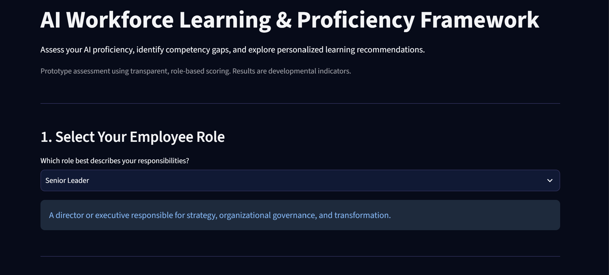
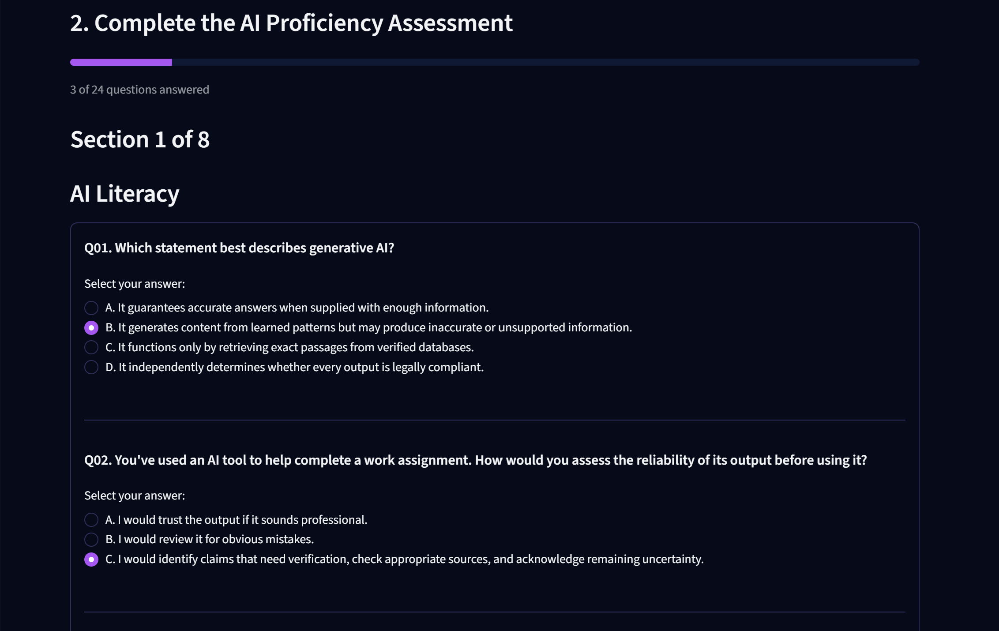
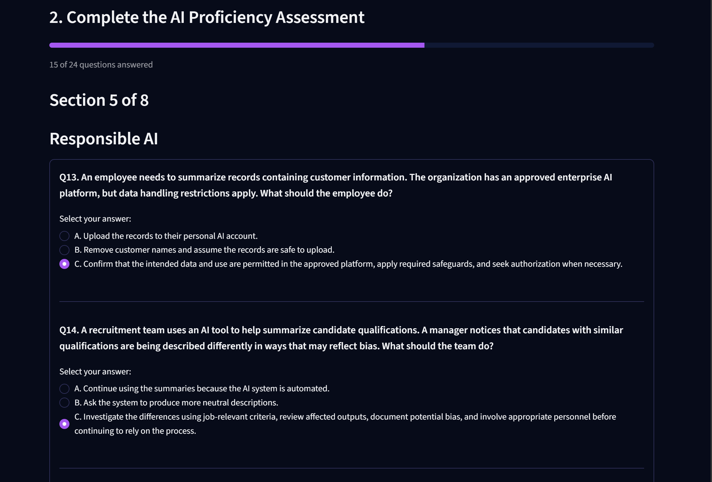
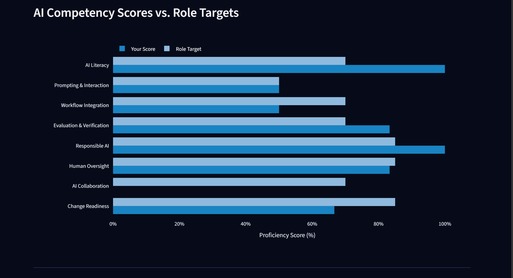
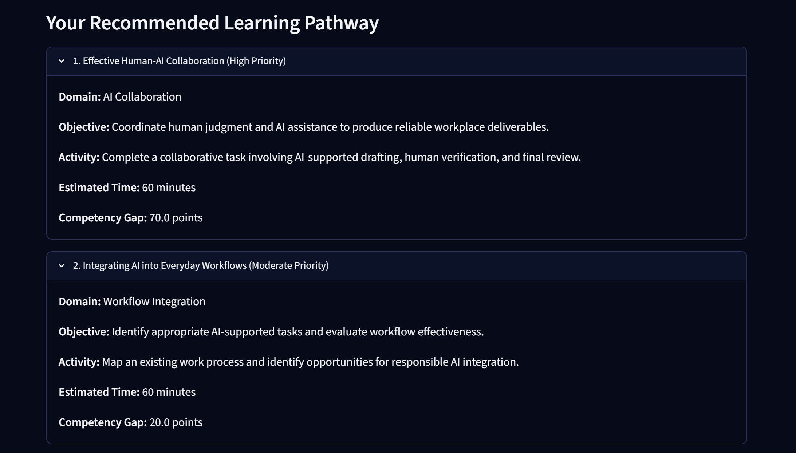
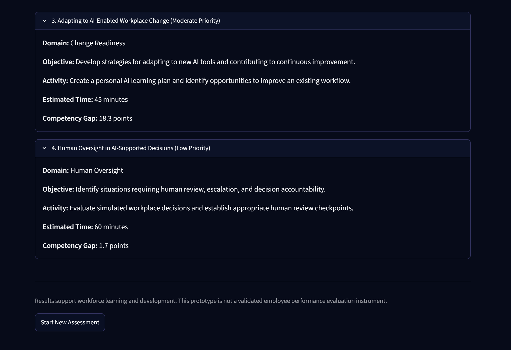

# AI Workforce Learning & Proficiency Framework

**Python | Streamlit | Plotly | Pandas | Workforce Analytics | AI Competency Assessment**

A Python and Streamlit application for assessing AI proficiency, identifying role-specific competency gaps, generating personalized learning recommendations, and examining organizational AI workforce readiness.

The framework combines a **24-question individual assessment** with an interactive workforce analytics dashboard using **1,500 synthetic employee records** across eight departments and six employee roles.

**Project Status:** Functional Prototype  
**Data:** Synthetic / Demonstration  
**Focus:** Applied AI, Workforce Development, Learning Analytics, Assessment Design

---

## 1. Project Overview

As organizations adopt artificial intelligence, workforce development increasingly requires more than access to AI tools. Organizations also need methods for understanding employee proficiency, identifying competency gaps, assessing readiness across job functions, and prioritizing learning opportunities.

The **AI Workforce Learning & Proficiency Framework** demonstrates how structured competency assessments, transparent scoring methods, and interactive analytics can support workforce development decisions.

The application has two primary components:

### Individual Assessment

A role-based AI proficiency assessment that evaluates knowledge, scenario-based decision-making, and self-reported practices across eight competency domains.

Employees receive domain-level results, role-target comparisons, and personalized learning recommendations based on their identified development needs.

### Organizational AI Workforce Analytics

An interactive dashboard that examines simulated workforce proficiency, training participation, AI adoption, management support, and competency gaps.

The dashboard supports department and employee-role filtering, organizational learning priorities, and downloadable reports.

---

## 2. Application Preview

### Individual AI Proficiency Assessment



*Interactive assessment interface with employee-role selection and structured AI competency questions.*

### Organizational AI Workforce Analytics


*Organizational workforce dashboard showing employee filters, proficiency indicators, role-target attainment, and competency gaps.*

---

## 3. Key Features

### Individual Assessment

- 24 structured questions across eight competency domains
- Six employee-role profiles
- Practical, knowledge, and reflection-based assessment items
- Weighted proficiency scoring
- Role-specific competency targets
- Assessment progress tracking
- Response review before submission
- Domain-level scoring and visualizations
- Personalized learning recommendations
- Priority-based learning pathways
- Ability to begin a new assessment

### Workforce Analytics

- Interactive department and employee-role filters
- Organizational AI proficiency overview
- Workforce proficiency distribution
- Department-level proficiency comparisons
- Organizational competency analysis
- AI tool access and adoption indicators
- Employee training participation
- AI usage frequency
- Management support indicators
- Role-specific competency gap analysis
- Workforce learning priorities
- Downloadable learning priorities in CSV format

---

## 4. AI Competency Framework

The assessment evaluates eight AI competency domains.

| Competency Domain | Description |
|---|---|
| AI Literacy | Understanding AI concepts, capabilities, and limitations |
| Prompting & Interaction | Communicating effectively with AI systems |
| Workflow Integration | Incorporating AI into existing work processes |
| Evaluation & Verification | Assessing and validating AI-generated information |
| Responsible AI | Applying privacy, fairness, bias, and responsible-use considerations |
| Human Oversight | Maintaining appropriate human judgment, accountability, and supervision |
| AI Collaboration | Working effectively with AI-assisted systems and processes |
| Change Readiness | Adapting to AI-related changes in workplace practices |

Each domain contains three assessment questions, resulting in a total of 24 questions.

The same eight domains are incorporated into the individual assessment, role-target comparisons, workforce competency analysis, and learning recommendations.

---

## 5. Employee Role Profiles

The framework includes six employee-role profiles with differentiated proficiency expectations.

| Employee Role | Primary Focus |
|---|---|
| Individual Contributor | Using AI to support everyday work activities |
| People Manager | Managing teams and supporting responsible AI adoption |
| Learning & Development Professional | Supporting workforce education, training, and competency development |
| Data or Technical Professional | Applying AI within data, analytics, and technical workflows |
| AI Workflow Owner | Managing AI-enabled processes and workflow integration |
| Senior Leader | Supporting organizational AI strategy, governance, and oversight |

Role-specific proficiency expectations are defined in `role_targets.json`.

Each role has target levels for all eight competency domains. This allows assessment results to be evaluated against job-related expectations rather than a universal benchmark.

The role definitions and target levels are prototype design assumptions and have not been externally validated as occupational standards.

---

## 6. Individual Assessment Design

### Assessment Structure

The assessment includes 24 questions organized into three scoring categories.

| Assessment Category | Purpose | Weight |
|---|---|---:|
| Practical | Scenario-based application and decision-making | 60% |
| Knowledge | Understanding AI concepts and appropriate uses | 30% |
| Reflection | Self-reported practices and awareness | 10% |
| **Total** | | **100%** |

Each question contains response options assigned scores between 0 and 4.

Some questions contain different numbers of response options because the answer structures reflect the specific knowledge, scenario, or practice being evaluated.

Regardless of the number of options, the maximum available score per question is four points.

### Assessment Progress and Review

The application tracks completed questions across all eight competency domains.

Before submission, users can review their responses and return to individual sections to make changes.

Once all 24 questions are completed, the assessment can be submitted for scoring.

### Assessment Example



*Example of the assessment interface and competency-based questions.*

---

## 7. AI Proficiency Scoring Methodology

Scoring calculations are implemented in `proficiency_scoring.py`.

The framework uses explicit, rule-based calculations to support transparent and reproducible results.

### 7.1 Assessment Category Scores

Each assessment category is independently normalized to a score between 0 and 100.

**Formula:**

Category Score = (Points Earned / Maximum Available Points) × 100

The maximum available points are calculated using the number of questions in the category multiplied by four.

### 7.2 Overall AI Proficiency

The overall proficiency score uses weighted assessment category results.

**Formula:**

Overall Proficiency = (Practical × 0.60) + (Knowledge × 0.30) + (Reflection × 0.10)

**Example calculation:**

| Category | Score | Weight | Weighted Result |
|---|---:|---:|---:|
| Practical | 75 | 60% | 45 |
| Knowledge | 80 | 30% | 24 |
| Reflection | 60 | 10% | 6 |
| **Overall** | | | **75/100** |

In this example, the employee receives an overall AI proficiency score of **75/100**.

The weighting system emphasizes practical decision-making and application. These weights represent prototype design choices rather than empirically validated predictors of workplace performance.

### 7.3 Domain-Level Competency Scores

Each of the eight competency domains contains three questions.

Maximum domain points:

3 questions × 4 points = 12 points

**Formula:**

Domain Score = (Domain Points Earned / 12) × 100

**Example:**

An employee earning eight points in AI Literacy receives:

(8 / 12) × 100 = **66.67/100**

Domain scores are calculated independently of the overall weighted score.

The overall score reflects assessment category weighting, while domain scores reflect responses associated with each competency.

---

## 8. Role-Specific Proficiency Targets

Each employee's domain scores are evaluated against the proficiency levels associated with the selected employee role.

### Proficiency Target Thresholds

| Target Level | Required Domain Score |
|---|---:|
| Level 1 | 25 |
| Level 2 | 50 |
| Level 3 | 70 |
| Level 4 | 85 |

Employees meet a competency target when their actual domain score equals or exceeds the required threshold.

### Competency Gap Calculation

**Formula:**

Competency Gap = Maximum of (0, Target Score − Actual Score)

**Example:**

- Required score: 70
- Actual score: 50
- Competency gap: 20 points

### Role-Target Attainment

Role-target attainment represents the percentage of competency domains in which an employee meets or exceeds the assigned target.

**Formula:**

Role-Target Attainment = (Domains Meeting Target / 8) × 100

For example, an employee who meets five of eight targets achieves:

(5 / 8) × 100 = **62.5% attainment**

This result is different from the employee's overall AI proficiency score.

Because domain scores are based on three scored questions, achievable percentages occur at discrete intervals. Small changes in target thresholds may not change attainment classifications when no achievable score falls between the thresholds.

---

## 9. Personalized Learning Recommendations

After completing the assessment, employees receive personalized learning pathways based on unmet role-specific competency targets.

Recommendations are produced through a deterministic, rule-based function using the employee's competency comparison results and a predefined learning catalog.

### Learning Priority Classification

| Priority | Classification Criteria |
|---|---|
| Critical | Responsible AI or Human Oversight gap of 20 points or more |
| High | Other gaps of 30 points or more |
| Moderate | Remaining gaps of 10 points or more |
| Low | Remaining positive gaps below 10 points |

Priority rules are evaluated in order.

For example, a Responsible AI gap of 35 points receives a Critical classification rather than High.

The application ranks recommendations by priority and then by competency gap magnitude.

Competencies meeting their assigned targets are excluded from recommendations.

### Learning Pathway Information

Recommended learning activities include:

- Competency domain
- Learning title
- Learning objective
- Suggested activity
- Estimated completion time
- Competency gap
- Learning priority

The learning catalog is stored in `learning_catalog.json`.

These recommendations are based on predefined development rules, not generative AI outputs or independently validated training prescriptions.

A Critical classification identifies a designated development priority and does not establish that an employee is unsafe or unqualified.

---

## 10. Organizational AI Workforce Analytics

The Workforce Analytics dashboard uses 1,500 synthetic employee records to demonstrate how individual competency results can be analyzed across an organization.

### Workforce Overview

The dashboard contains four primary indicators.

| Indicator | Calculation |
|---|---|
| Employees | Number of employee records included after filtering |
| Average AI Proficiency | Mean of individual overall proficiency scores |
| Average Role Attainment | Mean of individual role-target attainment percentages |
| Average Competency Gaps | Mean number of unmet competency targets per employee |

Filters allow users to select departments and employee roles.

All displayed analytics are recalculated using the selected workforce records.

### Demonstration Results

| Metric | Synthetic Result |
|---|---:|
| Employees | 1,500 |
| Average AI Proficiency | 57.3/100 |
| Average Role Attainment | 32.6% |
| Average Competency Gaps | 5.4 |
| Approved AI Tool Access | 48.1% |
| Training Completed | 31.7% |
| Daily AI Usage | 21.3% |
| Average Manager Support | 3.0/5 |

These are simulated demonstration values, not results from an actual employer.

### Workforce Proficiency Distribution

The dashboard displays how employees are distributed across the framework's overall proficiency classifications.

### Department Comparisons

Department-level charts display average AI proficiency and other workforce characteristics across organizational units.

### Organizational Competency Scores

The dashboard also calculates average scores across the eight competency domains.

These averages measure domain-level proficiency rather than the proportion of employees below their role-specific targets.

---

## 11. AI Adoption and Training Insights

In addition to proficiency assessment results, the dashboard examines simulated organizational AI adoption characteristics.

These include:

- Approved AI tool access
- Training completion
- AI usage frequency
- Management support for AI adoption
- Department-level differences

### Training Completion Rate

Training Completion Rate = (Employees Marked Completed / Employees Analyzed) × 100

### Approved AI Tool Access

Tool Access Rate = (Employees With Approved Access / Employees Analyzed) × 100

### Daily AI Usage

Daily Usage Rate = (Employees Reporting Daily Usage / Employees Analyzed) × 100

### Management Support

The dashboard calculates the arithmetic mean of employee manager-support ratings on a scale of 1 to 5.

These indicators are simulated independently from employee assessment responses. They should not be interpreted as evidence of causal relationships between AI adoption and employee proficiency.

---

## 12. Role-Specific Competency Gap Analysis

The organizational gap analysis identifies how frequently employees fall below the competency targets assigned to their roles.

Each employee's competency score is compared with the corresponding role-specific target.

### Organizational Competency Gap Rate

**Formula:**

Gap Rate = (Employees Below Target / Employees Analyzed) × 100

For example, if 1,077 of 1,500 employees fall below their Responsible AI targets:

(1,077 / 1,500) × 100 = **71.8%**

### Demonstration Results

| Competency Domain | Employees Below Target | Gap Rate |
|---|---:|---:|
| Responsible AI | 1,077 | 71.8% |
| AI Collaboration | 1,060 | 70.7% |
| Workflow Integration | 1,049 | 69.9% |
| Evaluation & Verification | 1,040 | 69.3% |
| Change Readiness | 1,028 | 68.5% |
| Prompting & Interaction | 1,016 | 67.7% |
| AI Literacy | 1,012 | 67.5% |
| Human Oversight | 811 | 54.1% |

**Important distinction:** Organizational gap rates describe how widespread unmet targets are, not the magnitude of each employee's competency gap.

For example, a 70% gap rate does not mean that the average competency score is 30/100.

---

## 13. Workforce Learning Priorities

The Workforce Analytics dashboard connects organizational competency gaps to predefined learning activities.

Recommended activities are ranked by the percentage of employees falling below their role-specific targets.

This allows the dashboard to identify competency domains with the broadest simulated workforce development needs.

### Individual vs. Organizational Learning Priorities

| Individual Assessment | Workforce Analytics |
|---|---|
| Uses individual competency gaps | Uses organizational gap prevalence |
| Assigns Critical, High, Moderate, or Low priorities | Ranks domains by the percentage of employees below target |
| Produces personalized learning recommendations | Identifies broader workforce learning priorities |
| Supports individual development planning | Supports organizational training planning |

The application includes a CSV export feature for the selected workforce learning priorities.

---

## 14. Synthetic Workforce Dataset

The application uses a generated workforce dataset containing 1,500 synthetic employees.

The data-generation script uses a fixed random seed of 42 to support reproducibility when the same code, inputs, and compatible library behavior are used.

### Dataset Characteristics

| Characteristic | Description |
|---|---|
| Employees | 1,500 |
| Departments | 8 |
| Employee roles | 6 |
| Competency domains | 8 |
| Assessment questions | 24 |
| Overall scores | Weighted assessment results |
| Domain scores | Normalized competency results |
| Role attainment | Percentage of assigned targets achieved |
| Competency gaps | Number of unmet domain targets |
| Adoption indicators | Simulated organizational characteristics |

### Department Selection Weights

| Department | Selection Weight |
|---|---:|
| Operations | 20% |
| Customer Service | 18% |
| Technology | 15% |
| Human Resources | 12% |
| Finance | 12% |
| Learning & Development | 10% |
| Marketing | 8% |
| Leadership | 5% |

These probabilities influence workforce composition but do not guarantee identical department counts.

### Simulated Employee Skill

Employee skill levels are initially sampled between 0.25 and 0.90.

Department-specific adjustments are applied to simulate differences in workforce AI readiness.

The adjusted values are limited to a range of 0.05 to 0.95.

These skill values influence the probability of choosing higher-scoring assessment responses.

### Synthetic Workforce Role Assignment

Employee roles are selected using department-specific probability weights.

For example, the generator gives technical roles a greater likelihood within the Technology department and learning-related roles a greater likelihood within Learning & Development.

These relationships are simulation assumptions rather than observations from real workforce data.

### Additional Indicators

The generator also assigns simulated values for:

- Training participation
- AI usage frequency
- Approved tool access
- Manager support

The completed dataset is exported to `synthetic_workforce.csv`.

---

## 15. Technical Architecture

The project uses the following technology stack.

| Technology | Function |
|---|---|
| Python | Assessment logic, scoring, and synthetic workforce generation |
| Streamlit | Individual assessment and organizational dashboard interfaces |
| Pandas | Data processing, filtering, and aggregation |
| Plotly | Interactive workforce and competency visualizations |
| JSON | Assessment questions, role targets, and learning catalog |
| CSV | Synthetic workforce data and downloadable reports |
| VS Code | Development environment |
| GitHub | Source code management and portfolio documentation |

### Application Components

**Individual_Assessment.py**

Provides the employee-facing assessment, role selection, question navigation, results, and personalized learning pathway interface.

**1_Workforce_Analytics.py**

Provides the organizational workforce dashboard, filters, charts, competency gap calculations, and downloadable learning priorities.

**proficiency_scoring.py**

Contains the scoring, classification, role-target comparison, and personalized recommendation functions.

**generate_workforce_data.py**

Generates the synthetic workforce dataset.

**validate_workforce_data.py**

Supports synthetic dataset validation.

**test_profiles.py**

Supports assessment profile testing.

**requirements.txt**

Lists the Python dependencies required to run the application.

**config.toml**

Defines the Streamlit visual theme, including the dark navy, purple, and teal color scheme.

---

## 16. Installation and Setup

### Prerequisites

- Python 3.12
- pip
- Git

### Clone the Repository

```bash
git clone https://github.com/glahnnia/ai-workforce-proficiency-framework.git
cd ai-workforce-proficiency-framework
```

### Create a Virtual Environment

```bash
python -m venv .venv
```

**Windows PowerShell:**

```powershell
.\.venv\Scripts\Activate.ps1
```

**macOS / Linux:**

```bash
source .venv/bin/activate
```

### Install Dependencies

```bash
pip install -r requirements.txt
```

### Launch the Application

```bash
python -m streamlit run Individual_Assessment.py
```

Streamlit provides navigation between the Individual Assessment and Workforce Analytics pages.

### Optional: Generate the Synthetic Workforce Dataset

```bash
python generate_workforce_data.py
```

This command generates a synthetic workforce dataset using the configured simulation assumptions.

**Important:** Running the generator overwrites its configured output CSV. The included demonstration dataset can be used without regenerating it.

### Validate the Dataset

```bash
python validate_workforce_data.py
```

### Run Profile Tests

```bash
python test_profiles.py
```

---

## 17. Individual Assessment Screenshot Gallery

The following screenshots demonstrate the assessment interface, competency questions, review process, proficiency results, and personalized learning pathways.

### Preview 1: Assessment Introduction


### Preview 2: Competency Assessment Questions


### Preview 3: Responsible AI Assessment Questions



### Preview 4: Assessment Review and Submission


### Preview 5: Individual Proficiency Results



### Preview 6: Competency Scores and Role Targets



### Preview 7: Personalized Learning Pathways



---

## 18. Workforce Analytics Screenshot Gallery

These screenshots illustrate the organizational analytics dashboard and its principal reporting features.

### Preview 1: Organizational Workforce Overview


### Preview 2: Workforce Proficiency Distribution


### Preview 3: Department-Level AI Proficiency


### Preview 4: AI Adoption and Training Insights


### Preview 5: Role-Specific Competency Gap Analysis


### Preview 6: Workforce Learning Priorities and Export


---

## 19. Methodological Limitations

The AI Workforce Learning & Proficiency Framework is a demonstration prototype.

**Synthetic Data**

All employee records, assessment responses, organizational characteristics, and AI adoption indicators are simulated.

**Assessment Validation**

The 24-question instrument has not undergone formal psychometric validation or external competency benchmarking.

**Limited Assessment Coverage**

Each competency domain contains three questions, providing preliminary developmental indicators rather than comprehensive evaluations of workplace performance.

**Role-Specific Targets**

The employee-role targets represent prototype assumptions and have not been validated against actual occupational performance requirements.

**Scoring Weights**

The overall scoring weights represent explicit framework design decisions, not empirically established relationships with workplace outcomes.

**Learning Recommendations**

Learning pathways are generated using predefined rules and learning activities. Their effectiveness has not been independently evaluated.

**Organizational Results**

The simulated dataset should not be used to infer actual employee proficiency, organizational AI readiness, or workforce development needs in real populations.

The application is intended for demonstration, learning, and exploratory workforce analytics, not high-stakes employment decisions or certification determinations.

---

## 20. Future Development Opportunities

Potential future enhancements include:

- Expanded competency assessment question banks
- Psychometric validation and reliability testing
- Additional role-specific assessment pathways
- Longitudinal employee proficiency tracking
- Pre- and post-training comparisons
- Learning completion and training effectiveness analysis
- More detailed competency gap severity indicators
- Additional workforce filters and reporting capabilities
- Secure user authentication
- Persistent assessment records
- Administrative reporting and organizational benchmarking

These are potential future development opportunities rather than features implemented in the current prototype.

---

## 21. Project Significance

The AI Workforce Learning & Proficiency Framework demonstrates an applied approach to combining workforce development, instructional design, assessment methodology, and data analytics.

The project illustrates how structured assessment systems can support:

- Identification of employee AI development needs
- Role-specific learning pathways
- Transparent proficiency scoring
- Organizational competency gap analysis
- Training investment prioritization
- Workforce AI adoption monitoring
- Evidence-informed learning and development planning

The framework also demonstrates how Python-based scoring systems, synthetic data generation, interactive dashboards, and predefined learning recommendations can be integrated into a functional workforce development application.

---

## Author

**Glahnnia “Renee” Rates**

Public Health Informatics | Applied AI | Workforce Development

Building practical AI and data systems that support workforce learning, healthcare, public health, and evidence-informed decision-making.

---

*All workforce data and assessment examples are synthetic or illustrative. This project was developed for demonstration, learning, and portfolio purposes.*
